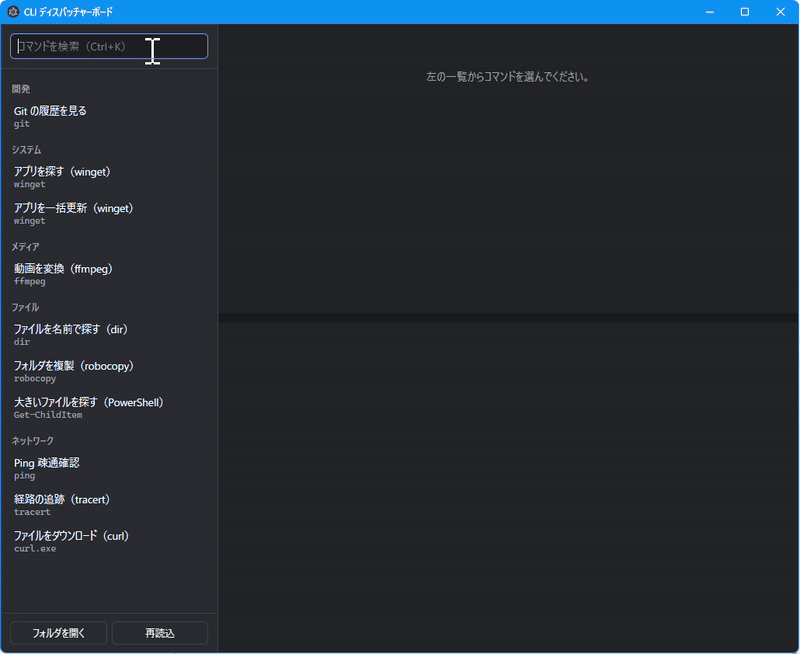

# CLI ディスパッチャーボード

CLI コマンドの起動パターンを登録しておき、GUI でパラメータを入力して実行するアプリです（Windows 11 向け、Electron 製）。

パラメータの仕様を覚えていなくても、一覧から選んで入力欄を埋め、「▶ 実行」を押すだけで、コマンドラインを組み立てて実行し、出力をその場で表示します。



- 左の一覧からコマンドを選ぶと、説明とパラメータの入力欄が出ます
- 入力すると、組み立てたコマンドラインがその場でプレビューされます（コピーもできます）
- 「▶ 実行」（Ctrl+Enter）で実行し、出力をリアルタイムに表示します。進捗バーや色付きの出力もターミナルと同じように出ます
- 実行するたびに出力のタブが開き、複数のコマンドを同時に動かせます。タブには実行中・成功・失敗の印が付き、一覧にも「実行中」と出ます
- 実行中は出力欄に直接キー入力できます。「■ 停止」で中断（1 回目は Ctrl+C、もう一度押すと強制終了）、「↻ 再実行」で同じ値のまま実行し直します
- 入力した値はコマンドごとに保存され、次回も残ります

## 準備

Windows 11 と Node.js（20 以上）が必要です。

```powershell
git clone https://github.com/hiro77284/cli-dispatcher-board.git
cd cli-dispatcher-board
npm install
npm start
```

`node-pty` は Windows 用のビルド済みバイナリが同梱されているので、通常は Visual Studio のビルドツールなしで入ります。

## コマンドの登録

`commands/` フォルダに YAML で書きます。保存すると自動で読み直します。書き方は [docs/command-format.md](docs/command-format.md) を参照してください。

```yaml
id: ping
name: Ping 疎通確認
category: ネットワーク
description: 指定したホストに応答があるか調べます。
program: ping
params:
  - name: host
    label: ホスト名
    required: true
  - name: count
    label: 回数
    type: number
    default: 4
args:
  - if: count
    args: ["-n", "{{count}}"]
  - "{{host}}"
```

同梱のサンプル：ping / tracert / curl ダウンロード / dir 検索 / robocopy / 大きいファイル探し（PowerShell）/ git log / winget 検索・更新 / ffmpeg 変換

## ショートカット

| キー | 動き |
|---|---|
| Ctrl+K | コマンドの検索へ |
| ↑ / ↓（検索欄で） | 一覧の選択を移動 |
| Enter（検索欄で） | 入力欄へ移動 |
| Ctrl+Enter | 新しいタブで実行 |
| Ctrl+Tab / Ctrl+Shift+Tab | 出力タブの切り替え |
| 中クリック（タブの上で） | タブを閉じる（実行中なら確認してから止める） |
| Ctrl+C（出力欄で文字を選択中） | コピー。選択していなければ実行中のプロセスに Ctrl+C を送る |

## 開発

```powershell
npm test   # コマンド組み立て・引用処理のテスト
```

構成：

- `src/main/build.js` … 定義と入力値から引数列と表示用コマンドラインを組み立てる（Electron 非依存）
- `src/main/commands.js` … YAML の読み込みと定義の検査
- `src/main/runner.js` … PATH からのプログラム探索と、起動方法（直接 / cmd.exe / PowerShell）の決定
- `src/main/winquote.js` … Windows のコマンドライン引用
- `src/main/main.js` … ウィンドウ、IPC、node-pty での実行
- `src/renderer/` … 画面（xterm.js で出力を表示）

環境変数 `CLI_BOARD_COMMANDS` に（`;` 区切りで）フォルダを指定すると、`commands/` の代わりにそこを読みます。

## 変更履歴

[CHANGELOG.md](CHANGELOG.md) を参照してください。

## ライセンス

[MIT](LICENSE)
